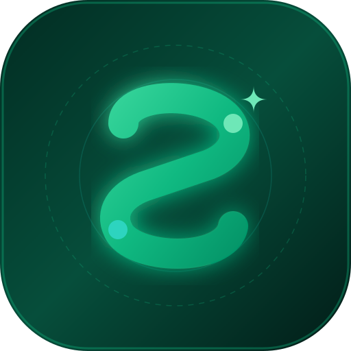
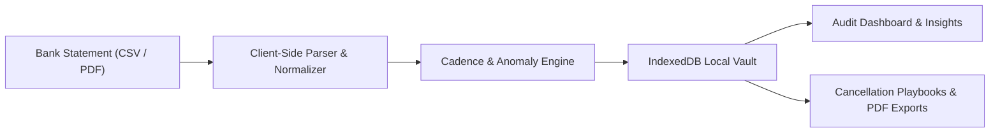

<p align="center">
  <a href="https://subsense.pages.dev" target="_blank" rel="noopener noreferrer">
    
  </a>
</p>

<h1 align="center">SubSense</h1>

<p align="center">
  <strong>Stop Paying for What You Don't Use.</strong><br>
  <em>AI-Powered Subscription Intelligence & Recurring Expense Auditor with Zero Bank Logins.</em>
</p>

<p align="center">
  <a href="https://subsense.pages.dev"></a>
  <a href="https://github.com/kishan-ict/SubSense"></a>
  
  
</p>

---

## ⚡ Overview

Traditional subscription auditing tools force users to link their live banking credentials through third-party data aggregators (like Plaid or Yodlee), granting continuous access to account balances and sensitive purchase history.

**SubSense is built on a zero-knowledge, local-first architecture.** Drop in an export statement from Chase, Bank of America, Amex, Revolut, Monzo, HDFC, or any UPI/Credit card provider, and SubSense automatically detects recurring patterns, flags stealth price hikes, uncovers overlapping subscriptions, and delivers step-by-step cancellation action guides—all without storing your financial records on a server.

---

## ✨ Key Features

| Capability | Details |
| :--- | :--- |
| 🛡️ **Zero Bank Logins** | 100% client-side statement processing. No bank credentials, card numbers, or live banking connections required. |
| 🔄 **Autonomous Cadence Detection** | Automatically groups charges by cadence (`monthly`, `annual`, `quarterly`, `weekly`) and filters out one-time debit noise. |
| 📈 **Stealth Price Hike Alerts** | Historical price anomaly engine detects silent dollar-amount and percentage increases across billing cycles. |
| 👥 **Duplicate Cluster Engine** | Flags redundant software and cloud tools (e.g. paying for Google One + Dropbox + iCloud simultaneously). |
| ⚡ **1-Click Cancellation Guides** | Direct links to vendor termination screens, difficulty ratings, certified warning notes, and auto-generated cancellation email templates. |
| 📊 **Interactive Spend Intelligence** | Category spend breakdowns (Entertainment, Productivity, Cloud, Gym, etc.) with projected annual savings. |
| 📑 **Executive PDF & Safe CSV Reports** | 1-click export of executive summary reports and CSV with formula injection protection (`=`, `+`, `-`, `@`). |
| 💾 **IndexedDB Persistence** | Encrypted client-side storage for historical audits with full reset/wipe control at any time. |

---

## 🏗️ Architecture & Tech Stack



- **Frontend & Framework**: Next.js 16 (App Router), React 19, TypeScript
- **Styling & UI**: Tailwind CSS, Lucide React, Glassmorphism design system
- **Data Visualizations**: Recharts
- **Parsing Engine**: PapaParse, custom text/token statement normalizer
- **Document Generation**: jsPDF
- **Edge Deployment**: Cloudflare Pages with Global CDN caching
- **AI Intelligence**: Google Gemini API via official `@google/genai` SDK

---

## 🚀 Quick Start & Local Setup

### 1. Clone the repository
```bash
git clone https://github.com/kishan-ict/SubSense.git
cd SubSense
```

### 2. Install dependencies
```bash
npm install
```

### 3. Configure environment (Optional)
If you wish to test AI-assisted merchant classification:
```bash
cp .env.example .env.local
```
Add your Google Gemini API Key:
```env
GEMINI_API_KEY=your_gemini_api_key_here
```

### 4. Run the development server
```bash
npm run dev
```

Open [http://localhost:3000](http://localhost:3000) in your browser.

---

## 🌐 Cloudflare Pages Deployment

SubSense is configured for instant, static HTML edge export:

```bash
# Production export build
npm run build

# Deploy to Cloudflare Pages
npx wrangler pages deploy out --project-name=subsense --branch=main
```

---

## 🔒 Security & Privacy Guarantee

- **No Third-Party Bank Trackers**: Zero tracking pixels, zero telemetry on statement entries.
- **Formula Injection Mitigation**: All CSV outputs sanitize special spreadsheet command triggers.
- **Client-Side Sandbox**: All parsing and analysis executes directly within the user's browser runtime.

---

<p align="center">
  <sub>Developed with precision and privacy for conscious financial freedom.</sub><br>
  <strong>SubSense © 2026</strong>
</p>
